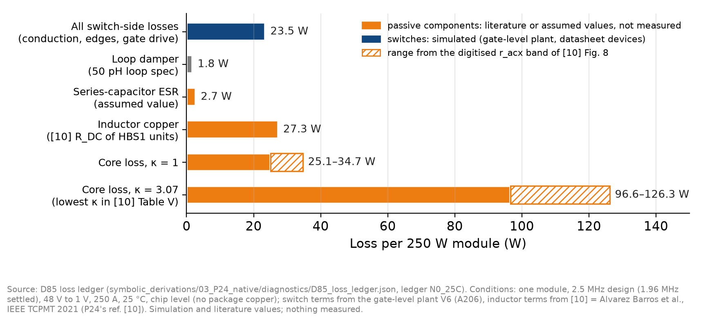
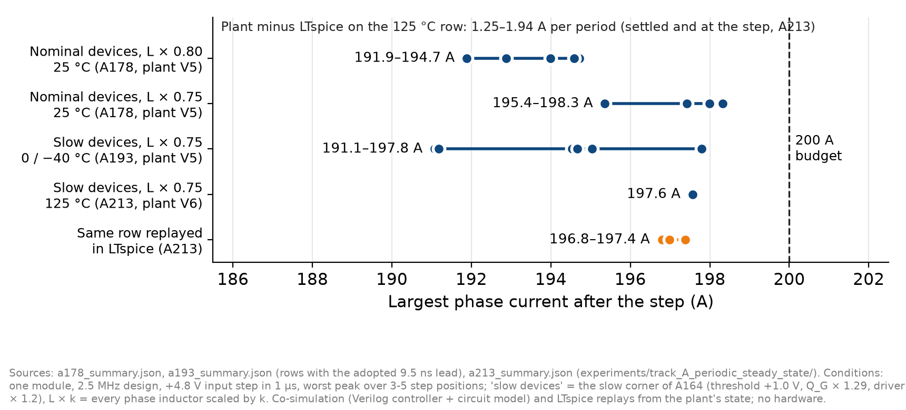

# SCB-IVR: what limits the results now, and why measured component data is the next step

Changan Jian · 19 November 2026 ·
[github.com/changanjian-lwy/ectc2024-scb-ivr-reproduction](https://github.com/changanjian-lwy/ectc2024-scb-ivr-reproduction)
· figures: `reports/figures/make_measurement_case.py` (no new runs; every number is read from a file in the repository)

**Summary.** The controller and the circuit model are now detailed enough that the main results are limited by
component values taken from the literature or assumed, not by the simulation. Three results show this:

1. **Efficiency.** Core loss in the inductor is somewhere between 25 and 126 W per 250 W module. All switch-side
   losses together are 23.5 W (Fig. 1).
2. **Switching frequency.** Whether 2.5 MHz or 5 MHz is the better design depends on the same unknown core-loss
   factor (Table 1).
3. **The 200 A peak budget.** At the worst tested corner only 2.2–2.4 A of margin is left. That is the same size as
   the difference between our circuit model and LTspice. It also depends on the spread of the real inductance, which
   has not been measured for these inductors (Fig. 2).

More simulation can compare models with each other, but it cannot narrow these ranges. Measuring the passive
components can.

## 1. Efficiency is set by the inductor core loss

**Fig. 1.** Loss per module by item, coloured by where each value comes from (D85 loss ledger, nominal devices,
25 °C, chip level).

- **Without core loss** the module reaches 82.4 %.
- **With core loss** from [10] Eq. (1):
    - at κ = 1 the efficiency is 73.9–76.1 %;
    - at κ = 3.07 it is 58.2–62.5 %. This is the lowest κ that [10] measured (Table V gives 3.07–5.07 at 2–5 MHz).
- **How large the unknown is.** The choice of κ alone moves the loss by 71–92 W. That is three to four times all
  switch-side losses together (23.5 W: conduction 15.7, edges and dead time 4.5, gate drive 3.4 W). Controller and
  switching work only acts on that 23.5 W.
- **The thermal design depends on the same number (D84, rerun on 23 October).** Taking a 25 °C coolant at a
  heat-transfer coefficient h = 2·10⁴ W/(m²K):
    - at κ = 1, keeping the hottest point at 85 °C needs a 2.6–7.1 % via fill in glass 1. The earlier, lower inductor
    losses needed only 0.12 %;
    - at κ = 3.07, no tested case keeps 85 °C, even with fills up to 19.6 % and h up to 10⁵ W/(m²K). The hottest point
    reaches 94–172 °C.

[10] = Alvarez Barros et al., IEEE TCPMT 11(12), 2021 (P24's reference [10]).

## 2. The frequency choice depends on the same unknown

**Table 1.** Efficiency (%) by switching frequency.

| Core loss | 1 MHz | 2.5 MHz | 5 MHz |
|---|---|---|---|
| none | 75.0 | 84.0 | 86.5 |
| κ = 1 | 70.4–73.4 | 75.2–77.5 | 75.0–76.6 |
| κ = 3.07 | 56.1–62.4 | 59.0–63.4 | 47.7–50.8 |

*Source:* D83 as corrected on 21 October (`d83_corrected` in D85_loss_ledger.json). *Conditions:* three design
records, 25 °C, no package. Ranges come from the r_acx band. The semiconductor terms come from D73, so the 2.5 MHz
row differs slightly from Fig. 1.

- **Without core loss**, 5 MHz is the best frequency.
- **At κ = 1**, 2.5 MHz leads 5 MHz by only 0.2–0.9 points (same edge of the band).
- **At κ = 3.07**, 5 MHz is 11–13 points worse than 2.5 MHz (same edge of the band).

So the design frequency follows from a κ we have not measured.

## 3. The 200 A margin is the size of the model error

**Fig. 2.** Largest phase current after a +4.8 V / 1 µs input step, for the worst tested corners. The circuit model
is labelled by version: V5 has gate-driven switches; V6 adds zero-voltage-switching edges and switch resistances.

- **The worst tested corner** is slow devices with every inductor at 0.75 L0. With the final configuration it
  reaches 191.1–197.8 A at 0 and −40 °C (A193, plant V5) and 197.6 A at 125 °C (A213, plant V6). That leaves
  2.2–2.4 A of margin.
- **The same row in LTspice.** A213 replayed this row in LTspice. The peak there is 196.8–197.4 A, and the phase
  currents differ from our model by 1.25–1.94 A per period. A213's own conclusion is that the result "remains a
  statement about two models, not hardware".
- **Sensitivity to inductance.** With nominal devices, the worst peak is 191.9–194.7 A at 0.80 L0 and 195.4–198.3 A
  at 0.75 L0 (A178). So between 0.80 and 0.75 L0, the worst peak rises by 3.6 A. Whether the design keeps 200 A
  therefore depends on the spread of the real inductors, which is an input we do not have.

## 4. Where the model's passive values come from

| Quantity | Value in the model | Source | How it can be measured |
|---|---|---|---|
| Inductance per phase and its spread | 2.933 nH; 200 A holds down to 0.75 L0 (A178) | design value; spread unknown | small-signal impedance, several units |
| Inductor DC resistance | 376 µΩ/nH (IND048, HBS1) → 27.3 W per module | [10] Table II | four-wire DC |
| Inductor AC loss r_acx | digitised band | [10] Fig. 8 | impedance R(f) and Q(f) |
| Core-loss factor κ | 1 or 3.07 | assumed / [10] Table V | large signal, at converter level |
| Series capacitors: ESR | assumed; 2.7 W per module | D62 middle scenario | impedance |
| Series capacitors: ESL, and C at 12 / 24 / 36 V | not in the circuit model | none | impedance with bias; pH-level ESL needs an RF VNA |
| Output capacitor: ESR, ESL | not in the circuit model | none | impedance |
| GaN switches | vendor LTspice model | datasheet, matched within 1–8 % (D79) | double-pulse test; low priority |

## 5. Limits of this argument

- **Nothing here is measured.** Every number comes from simulation (co-simulation plants V5 and V6, LTspice replays)
  with passive values taken from the literature or assumed.
- **A small-signal measurement is the first step, not the whole answer.** It narrows the r_acx band, the inductance
  spread and the capacitor ESR / ESL. κ, the largest term, needs a large-signal measurement at converter level.
- **Only samples of the same technology change these numbers directly.** That means embedded HBS1-type inductors and
  the capacitors used in the design. Other samples test the measurement method and the form of the model (for
  example, whether a constant series resistance is enough), but not the SCB values.
- **More simulation cannot close these gaps.** Some simulation items remain open (`reports/CURRENT_STATUS.md`). None
  of them can narrow the ranges in Sections 1–3, because those ranges come from component inputs, not from the
  model.

## 6. Proposed next steps

1. **Predict.** For each available inductor and capacitor sample, write down the model's prediction from Section 4
   (L, R(f), Q, ESR, ESL) before measuring.
2. **Measure and compare.** Measure the samples' impedance and compare with the predictions. Report which
   differences are only values and which show an element the model is missing.
3. **Plan the core-loss measurement.** Then plan a large-signal core-loss measurement for κ at converter level.
